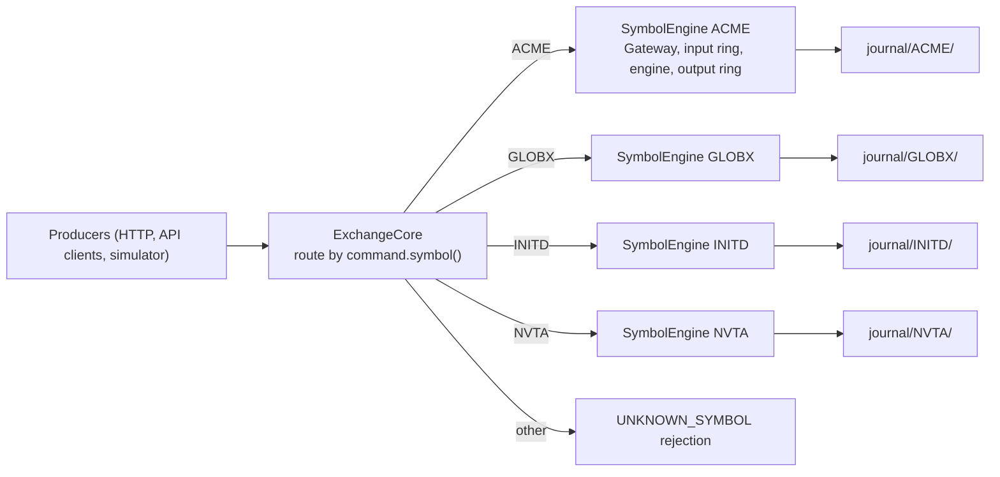
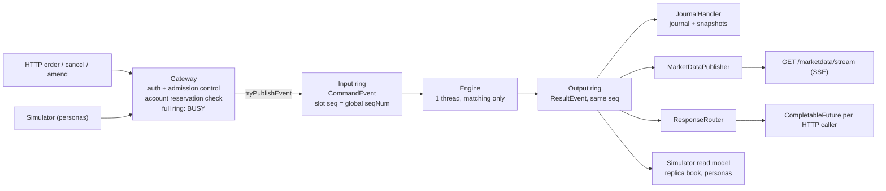
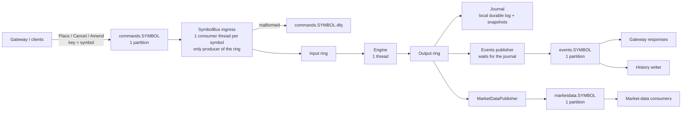
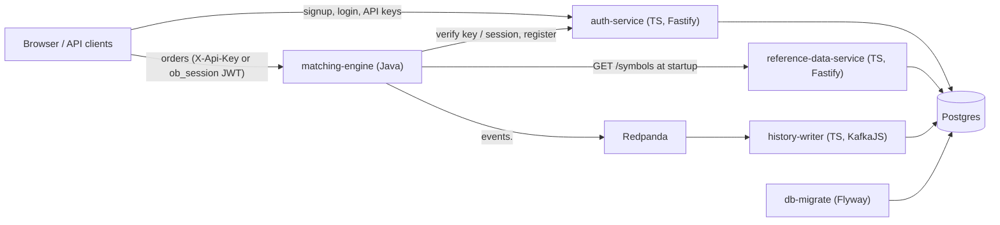

# Architecture

[Back to README](README.md)

Internals of the matching engine service (`services/matching-engine/`): the per-symbol exchange core, the Disruptor
pipeline, the event bus, the participant API, the market-data feed and the market simulator.

## Matching engine

An in-memory matching engine for one symbol (`orderbook.MatchingEngine`, `orderbook.OrderBook`). It is
deterministic and single-threaded, uses integer prices (ticks) and quantities, and never uses floating point. A new
engine is empty: no resting orders, no last or reference price; prices are discovered only from incoming flow.

- **Commands:** `Place`, `Cancel` and `Amend` all go through `MatchingEngine.process(Command)` and produce events:
  `OrderPlaced`, `TradeExecuted`, `OrderCancelled`, `OrderAmended`, `OrderRejected`.
- **Matching:** price-time priority, with FIFO order taken from an engine-assigned `seqNum`. Trades execute at the
  resting (maker) order's price, and orders sweep across multiple price levels.
- **Order types:** `LIMIT` and `MARKET`.
- **Time in force:**
  - `GTC`: the unfilled remainder rests in the book.
  - `IOC`: the unfilled remainder is cancelled.
  - `FOK`: all-or-nothing, checked first with a dry run, so a rejected order leaves the book untouched.
- **Amend:** a quantity decrease at the same price keeps the order's queue position. A price change or quantity
  increase sends the order to the back of the queue, and it can cross the book like a new order.
- **Self-trade prevention:** cancel-taker. An incoming order that would match the same participant's resting order is
  cancelled, and the resting order is left alone.
- **Validation:** invalid input is returned as `OrderRejected` events and never thrown. This covers non-positive
  price or quantity, duplicate order IDs, and unknown order IDs. A command for another symbol is rejected with
  `WRONG_SYMBOL` before it touches the book (cannot happen behind the router).

The book stores each side as a `TreeMap` of price levels with a FIFO queue per level, plus a hash index for O(1) cancels.

## Symbols and the exchange core

One engine process hosts every listed symbol, each with its own matching engine, pipeline and journal (as IBKR runs
one book per instrument). Symbols are a fixed set in `orderbook.Symbols`: `ACME`, `GLOBX`, `INITD`, `NVTA`.

- **Symbol on every command:** `Order` carries a `symbol`, and `Command` exposes `symbol()` (`Place` takes the
  order's, `Cancel(symbol, orderId)`, `Amend(symbol, orderId, newPrice, newQty)`). Constructors without a symbol
  default to `Symbols.DEFAULT` (`ACME`), so single-symbol callers and tests are unchanged.
- **`ExchangeCore`** (`orderbook.exchange`) owns a `Map<String, SymbolEngine>` built at startup. A `SymbolEngine`
  bundles one symbol's `Pipeline` (own input ring, engine thread, output ring and consumers), its `Gateway` and its
  `Journal`. `ExchangeCore.submit` routes by `command.symbol()`; an unlisted symbol is rejected with
  `UNKNOWN_SYMBOL` before reaching any ring. Responses are awaited on that symbol's pipeline
  (`awaitResponse(symbol, seq, timeout)`).
- **Isolation:** symbols share no book, sequence, thread or lock, so an `ACME` order can never match a `GLOBX`
  order, and a burst on one symbol only backs up its own ring (`BUSY` stays per symbol). `seq`/`seqNum` are per
  symbol. The only shared state is the order-id counter (all gateways share one `AtomicLong`), keeping order ids
  unique exchange-wide.
- **Today's wiring:** `DemoServer` builds an `ExchangeCore` for all four symbols. The simulator, the browser, the
  participant API and the market-data stream are attached to `ACME`'s engine; the other books start empty and stay
  empty until external flow is routed to them.



## Journal, snapshots and recovery

`orderbook.journal.Journal` is an event-sourced log in a directory. Each symbol journals into its own subdirectory,
`DIR/<SYMBOL>/` (`-Djournal.path=DIR` in the server), written by that symbol's `JournalHandler` from its output ring
in that symbol's sequence order. Every symbol's journal is self-contained and recovers on its own
(`ExchangeCore.recover(root, symbol)` / `Journal.recover(symbol)`); a corrupt journal for one symbol does not affect
the others.

- **Format v2:** segments `journal-000001.log`, … start with `#orderbook-journal v2 base=<seq>`; each line is
  `<crc32 hex>:{"seq":N,"cmd":…,"sym":"ACME",…}` (CRC32 of the JSON). Entries record their symbol; an entry
  without `"sym"` (written before symbols existed) decodes as `ACME`. Unversioned v1 JSON Lines journals are
  rejected, not silently read.
- **Snapshots:** `snapshot-<seq>.json` holds the complete engine state (every resting order with id, participant,
  side, type, TIF, price, remaining qty and seqNum; accepted IDs; seqNum and order-ID counters) covering exactly
  journal sequence `seq`. In the pipeline they are sequenced: `tryPublishSnapshot()` markers, every N commands
  (`setSnapshotInterval`, `-Djournal.snapshotEvery`, default 10000) and resets. The engine thread serializes the
  state into the result slot; the journal consumer writes it (temp file, fsync, atomic rename), then rotates to a
  new segment.
- **Recovery:** `Journal.recover()` loads the newest snapshot and replays only entries with `seq` > its `seq`; with no
  snapshot it replays every segment. A CRC or parse failure mid-segment is a hard corruption error; a torn or
  corrupt last line is dropped and truncated on the next append.
- **Durability (`-Djournal.durability`):** `FLUSH` (default) writes each line to the OS: survives a process crash,
  may lose recent commands on power loss or OS crash. `FSYNC` adds `FileChannel.force` every N commands or T ms,
  whichever is first (`-Djournal.fsyncEvery=64`, `-Djournal.fsyncMillis=10`): an OS crash loses at most the
  last unforced batch. Snapshots are always fsynced.
- **Retention:** covered segments and older snapshots are kept; `pruneCoveredSegments()` deletes them on demand.

## Pipeline

Each symbol's engine runs behind its own explicit [LMAX Disruptor](https://lmax-exchange.github.io/disruptor/)
pipeline (`orderbook.pipeline.DisruptorPipeline(symbol)`, threads named `pipeline-<SYMBOL>-N`). Matching logic is
unchanged; the pipeline only decides who feeds the engine, in what order, and who hears about the results. The
diagram shows one symbol's pipeline; every symbol has an identical, independent one.



- **Input ring (sequencer):** a preallocated, power-of-two `CommandEvent` ring with multiple producers. Every API
  call (browser, external clients and simulated participants alike) is authenticated and admission-checked first
  (see [Participant API](#participant-api)), then `Gateway` runs the user's account reservation check and claims a
  slot with `tryPublishEvent()`. The slot's sequence is the command's `seqNum` within that symbol.
- **Backpressure:** a full ring never blocks a producer; the command is rejected with `OrderRejected` reason
  `BUSY` and its reservation is released.
- **Engine:** a single `EventHandler` thread that only matches; no I/O. `BlockingWaitStrategy` on both rings.
- **Output ring (fan-out):** every result goes onto a second ring read by independent handlers, each on its own
  thread with its own cursor: the journal writer, the market-data publisher, the response router (completes the
  waiting HTTP caller's `CompletableFuture`, keyed by sequence) and the simulator's read model. A slow handler
  only falls behind. Matching waits only once a handler lags by a whole output ring, and producers then see `BUSY`.

## Event bus

Between services, the matching engine talks over a Kafka-compatible event bus
([Redpanda](https://redpanda.com/), single broker, `docker-compose.yml` at the repo root). The standalone service
`orderbook.bus.EngineService` (image built from `services/matching-engine/Dockerfile`) runs one `SymbolBus` per
listed symbol: it consumes `commands.<symbol>`, feeds that symbol's Disruptor input ring and publishes the output
ring to `events.<symbol>` and `marketdata.<symbol>`. The bus is the transport; each symbol's journal stays the local
durable log. (The in-process demo server, `DemoServer`, still feeds the rings directly.)

### Topics

| Topic | Producer → consumer | Record value | Retention |
|---|---|---|---|
| `commands.<symbol>` | gateway / clients → matching engine | one Place, Cancel or Amend ([`commands.schema.json`](schemas/bus/commands.schema.json)) | forever |
| `events.<symbol>` | matching engine → gateway, history writer, … | one record per sequenced command: `seq`, `participantId`, echoed `correlationId`, `ts`, `commandOffset`, the `command` and its `events` array ([`events.schema.json`](schemas/bus/events.schema.json)) | forever |
| `marketdata.<symbol>` | matching engine → market-data consumers | the [Market data](#market-data) snapshot / delta messages ([`marketdata.schema.json`](schemas/bus/marketdata.schema.json)) | 24 h |
| `commands.<symbol>.dlq` | matching engine → operators | command records that failed to decode, unchanged, with `error` and `source.offset` headers | default |

- **Encoding:** JSON (UTF-8), JSON Schema 2020-12 files in [`schemas/bus/`](schemas/bus/), schema version `v: 1`.
  JSON keeps the wire format readable with `rpk` and consumable from any language without generated code; the codec
  (`orderbook.bus.BusCodec`) rejects unknown fields so a typo fails loudly rather than being ignored. Prices are
  integer ticks (100 = 1.00), quantities integers, enums upper-case strings.
- **Partitioning and ordering:** every topic has exactly one partition and records are keyed by symbol, so each
  symbol's commands, events and market data are each totally ordered. The engine creates its topics at startup and
  refuses to run if one has more than one partition; compose disables auto-creation.
- **Correlation:** `correlationId` is an optional opaque string on a command, echoed unchanged (or `null`) on that
  command's events record together with `participantId` and `seq`, so a gateway can do request/response over the bus.
- **Order ids:** a client-supplied `orderId` on Place is kept; a reused one is rejected with `DUPLICATE_ORDER_ID`.
  When absent the engine assigns one, striped by symbol (`id % 16` = listing index + 1) so ids stay unique
  exchange-wide while each symbol derives its next id from its own state.
- **Invalid commands** go to `commands.<symbol>.dlq` and consume no `seq`. Commands the engine rejects
  (unknown order, bad price, …) are sequenced and published like any other, with an `OrderRejected` event.



### Single writer and sequencing

One consumer thread per symbol reads `commands.<symbol>` partition 0 and is the only producer of that symbol's input
ring, so ring order is topic order and each command gets the next global `seq` (contiguous from 0, continuing across
restarts). A full input ring is backpressure: the consumer waits for a slot instead of rejecting with `BUSY`. The
output ring fans out to three independent consumers: the journal writer, the events publisher and the market-data
publisher. The events publisher sends a command's record only after the journal has written it, through one
idempotent producer (`acks=all`); consumer offsets on `commands.<symbol>` are committed once events are acknowledged
(informational: recovery does not rely on them).

### Restart and recovery

The engine is crash-only: any bus or journal error exits the process, and a restart recovers. At startup each symbol:

1. reads the last `events.<symbol>` record (seq `P`, and its `commandOffset`) and the journal's last seq `J`;
2. rebuilds the engine as of `R = min(P, J)` from the journal (`Journal.load(R)`: newest snapshot at or before
   `R`, plus the entries after it) and starts a pipeline whose first seq is `R + 1`;
3. resumes consuming `commands.<symbol>` right after the command sequenced at `R` (the `commandOffset` of the
   events record for `R`).

Commands are re-processed deterministically, so for seqs up to `J` the re-derived command is checked against the
journal instead of re-journaled (a mismatch is fatal), and seqs up to `P` are not re-published. Every seq therefore
reaches `events.<symbol>` exactly once, in order, whether the engine crashed before journaling, after journaling but
before publishing, or lost its journal entirely (then `R = -1` and the journal is rebuilt from the retained
commands topic). `marketdata.<symbol>` starts each run with a snapshot as of `R` and then one delta per seq; a fresh
snapshot every 1000 seqs lets a consumer resync after retention truncates the topic.

### Running it

```
docker compose up --build                 # Redpanda + matching engine (journal in the engine-journal volume)
docker compose exec redpanda rpk topic produce commands.ACME -k ACME
{"type":"Place","participantId":7,"correlationId":"c-1","side":"SELL","price":10000,"qty":5}
docker compose exec redpanda rpk topic consume events.ACME
```

Host clients use `localhost:19092`. Configuration (environment): `KAFKA_BOOTSTRAP_SERVERS`, `SYMBOLS`,
`JOURNAL_PATH`, `SNAPSHOT_EVERY`, `TOPIC_REPLICATION`. `MatchingEngineBusIT` (Testcontainers Redpanda, run by
`mvn verify`) publishes to `commands.ACME`, consumes `events.ACME` and checks matching, `seq` order, correlation,
the DLQ, market data, restart without republishing, and rebuilding a lost journal from the bus.

## Brokerage services and Postgres

Postgres is the system of record for identities, accounts, reference data and history. Every service owns its own
tables, and the matching engine never touches the database: it stays an in-memory, journal-backed sequencer.



| Component | Stack | Owns | Doc |
|---|---|---|---|
| `db/migrations` | Flyway 10, plain SQL | schema history for every service | below |
| `auth-service` | TypeScript, Node 22, Fastify 5, `pg`, bcrypt, `jose` | `users`, `accounts`, `api_keys` | [README](services/auth-service/README.md) |
| `reference-data-service` | TypeScript, Node 22, Fastify 5, `pg` | `reference_data` (read side) | [README](services/reference-data-service/README.md) |
| `history-writer` | TypeScript, Node 22, KafkaJS, `pg` | `orders_history`, `trades_history` | [README](services/history-writer/README.md) |

TypeScript and Fastify are a common choice for identity and edge services, and they share one toolchain with the
gateway and frontend. The migrations are plain SQL, so a service in any language (such as the Python portfolio
service) adds its own `V<n>__*.sql` file to the same history. Compose runs `db-migrate` as a one-shot job, and every
database client waits for it to complete successfully.

### Schema

- **`users`**: the username is unique case-insensitively (`lower(username)`). `kind` is `human` or `simulated`.
  `password_hash` is a bcrypt hash, and it is null only for simulated users, who authenticate with API keys.
- **`accounts`**: one per user. `participant_id` comes from `participant_id_seq`, which starts at 1001. Participant 1
  stays the anonymous `YOU` seat, and 0 means no participant. `starting_cash` is the sum of the active
  `initial_cash_grant` values at signup.
- **`api_keys`**: `key_hash` is the SHA-256 of the key (32 bytes, `BYTEA`), and the plaintext `ob_<48 hex>` is
  returned only when the key is issued. The table also keeps `key_prefix` for display, `label`, `last_used_at` and
  `revoked_at`.
- **`reference_data`**: `symbol`, `name`, `currency`, `tick_size NUMERIC(18,8)`, `lot_size`,
  `initial_cash_grant NUMERIC(18,2)`, `active` and `display_order`. `V2` seeds ACME, GLOBX, INITD and NVTA.
- **`orders_history` / `trades_history`**: append-only. Each row is unique on `(symbol, seq, event_index)`, where
  `seq` is the engine's per-symbol sequence and `event_index` is the event's position in the `events.<symbol>`
  record. Prices are integer ticks (`price_ticks`), and extra fields go in `details JSONB`.

### Auth contract

- Signup and login (`POST /auth/signup`, `POST /auth/login`, with JSON `{username,password}`) return an RS256 JWT and
  also set it as the `HttpOnly` `ob_session` cookie. The claims are `sub` (user id), `participantId`, `accountId`,
  `username` and `kind`, with issuer `devin-demo-auth` and audience `devin-demo`. Tokens expire after 1 h by default.
- Verifiers check the token locally against `GET /.well-known/jwks.json` (matching on `kid`), so they need no shared
  secret and no call per request. `JWT_PRIVATE_KEY` (PKCS#8 PEM) pins the signing key. Without it, each start
  generates a new key, and tokens issued before the restart stop verifying.
- Unknown usernames and wrong passwords get the same `401`.
- Internal lookups are `GET /internal/api-keys/verify` with the key in the `X-Api-Key` header (headers stay out of
  access logs) and `GET /internal/participants/{id}`. When `INTERNAL_TOKEN` is set, these routes require the
  matching `X-Internal-Token`.
- `POST /participants/register` creates a simulated user, its account and its first API key in one transaction. The
  simulator's participants get real accounts this way.

### Reference data in the engine

`Symbols.ALL` is now only the built-in fallback. `EngineService` hosts `SYMBOLS` if it is set, otherwise the
active listing from `REFDATA_URL` (fetched with retries while compose starts), and otherwise `Symbols.ALL`.
`DemoServer` works the same way and serves the listing at `GET /api/symbols`, which the page uses for its header. A
hosted symbol only needs to be a well-formed code (`[A-Z][A-Z0-9]{0,9}`, `Symbols.requireValid`); it does not have
to appear in `Symbols.ALL`.

### History

`history-writer` consumes every topic matching `^events\.[A-Z][A-Z0-9]{0,9}$` in consumer group `history-writer`.
KafkaJS resolves a regex subscription only once, at subscribe time, but the engine creates its topics when it starts.
The worker therefore lists topics itself on startup and every `TOPIC_DISCOVERY_MS`. When a new listing appears, it
re-subscribes the group, keeping the committed offsets. It maps each record
(`schemas/bus/events.schema.json`) to rows. `OrderPlaced`, `OrderAmended`, `OrderCancelled` and `OrderRejected`
become `orders_history` rows, and `TradeExecuted` becomes a `trades_history` row. A record's rows are written in one
transaction with `ON CONFLICT DO NOTHING`, and the offset is committed only afterwards. Redelivery is therefore
idempotent, and the history matches the engine's sequence exactly. Records that fail to parse are logged and skipped
as poison messages. A database error stops consumption without committing, so the record is retried.

## Participant API

Endpoints and an example are in the [README](README.md#participant-api).

- **Authentication:** the server resolves callers through a `ParticipantDirectory`. With `AUTH_SERVICE_URL` set it
  is `AuthServiceDirectory`, which looks up API keys (`GET /internal/api-keys/verify`) and session JWTs
  (`GET /auth/me`) against the [auth service](#brokerage-services-and-postgres) and registers participants there.
  Positive lookups are cached for 30 s (`auth.cacheSeconds`), and unknown keys for a tenth of that. Labels are
  fetched in the background so the market-data path never blocks. If the auth service is unreachable, callers get
  `503 AUTH_UNAVAILABLE` instead of `401`. Without `AUTH_SERVICE_URL` (tests and the in-page build), the in-memory
  `ParticipantRegistry` is used. A missing or unknown key gets `401`, and touching another participant's order is
  rejected with `NOT_OWN_OPEN_ORDER`.
- **Browser sessions:** someone who signed up or logged in carries the auth service's JWT in the `ob_session`
  cookie and trades as their own account, and the page never overwrites that cookie. Anonymous visitors get the
  local reserved key for `YOU` (participant 1), which can never be registered.
- **Admission control:** checks run in the gateway before anything is published to the input ring. Each
  participant has a token bucket of 200 messages/sec with a burst of 400 (orders, cancels and amends each cost one)
  and may have at most 100 open orders. A breach gets `429` with reason `RATE_LIMITED` or `MAX_OPEN_ORDERS`.
- **Blocking:** after 100 violations a participant gets `403 BLOCKED` on every call. `POST /api/reset` clears
  the counters.
- Responses carry the order ID, the global `seq` and the engine's events. `YOU` also gets its book and account view.

## Market data

`MarketDataPublisher` turns engine events into an aggregated (L2) feed, one message per global `seqNum`:

- `snapshot`: `{"type":"snapshot","seq":S,"bids":[[price,qty,orders],…],"asks":[…],"trades":[…],"events":[…]}`
- `delta`: `{"type":"delta","seq":N,"levels":[["a"|"u"|"r","B"|"S",price,qty,orders],…],"events":[…]}`. Trade
  prints are `TradeExecuted` entries in `events`. Prices are integer ticks.

`GET /marketdata/stream` is Server-Sent Events. Its first message is always a snapshot, taken under the same lock
that applies results, so there is no snapshot/subscribe race. After snapshot `S`, deltas arrive as `S+1`, `S+2`, …
with no holes. Any other sequence is a gap, and the client resyncs from a fresh snapshot. A slow client's backlog
is replaced by a single snapshot. The page keeps a local book replica from the snapshot plus deltas, and the
event log and trade tape filter the same stream. Account state is polled from `GET /api/account`.

## Market simulator

`orderbook.sim.Simulator` is an orchestrator of API clients. Each simulated participant runs on its own client thread,
registers through `POST /participants/register` and trades over HTTP with its own key and limits.

- **Turns:** each Poisson arrival deals one participant a turn: a snapshot of the market (reference price, top 10
  levels, its own orders), which its persona turns into authenticated order/cancel/amend calls.
- **Reproducibility:** runs are reproducible from a seed when participants run in-process (the static demo and
  tests).
- **Risk tolerance:** each participant is assigned a persona and a hidden `riskTolerance` between 0 and 1 when it
  joins. A market maker's spread and readiness to leave depend on it.

## Your account (`YOU`)

Every order from `YOU` is checked against its cash and share balance before it reaches the engine (the `Gateway`
account reservation check above). Buys reserve cash and sells reserve shares until the order fills or is cancelled;
fills settle at the trade price, and any unused reservation is refunded.
