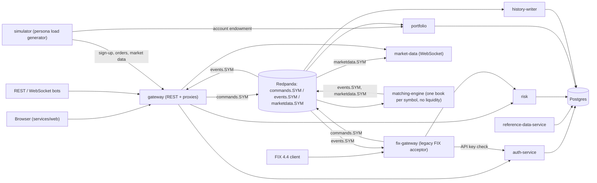
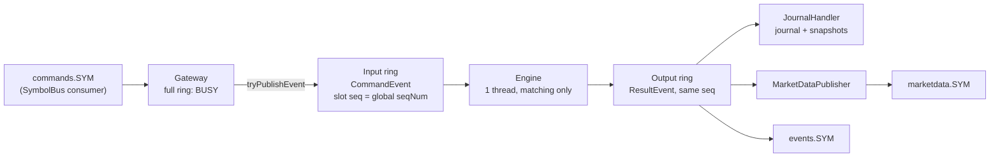
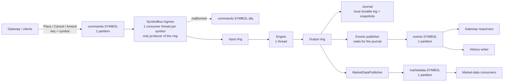
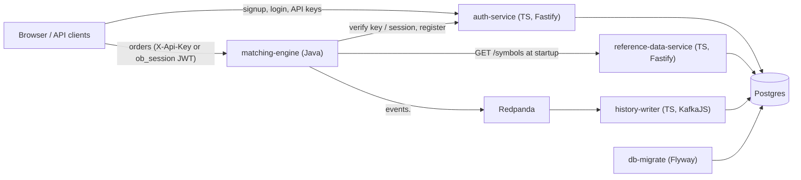
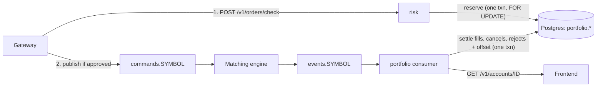
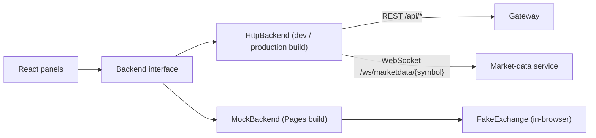

# Architecture

[Back to README](README.md)

Internals of the services: the per-symbol exchange core and its Disruptor pipeline, journal and event bus
(`services/matching-engine/`), the brokerage services, the gateways, market data, the market simulator and the web
frontend. The matching core is empty plumbing: it never quotes or discovers a price. All liquidity comes from
outside participants, in practice the simulator.

## End-to-end topology



## Matching engine

An in-memory matching engine for one symbol (`orderbook.MatchingEngine`, `orderbook.OrderBook`). It is
deterministic and single-threaded, uses integer prices (ticks) and quantities, and never uses floating point. A new
engine is empty: no resting orders, no last or reference price; prices are discovered only from incoming flow.

- **Commands:** `Place`, `Cancel` and `Amend` all go through `MatchingEngine.process(Command)` and produce events:
  `OrderPlaced`, `TradeExecuted`, `OrderCancelled`, `OrderAmended`, `OrderRejected`.
- **Matching:** price-time priority, with FIFO order taken from an engine-assigned `seqNum`. Trades execute at the
  resting (maker) order's price, and orders sweep across multiple price levels.
- **Order types:** `LIMIT` and `MARKET`.
- **Time in force:**
  - `GTC`: the unfilled remainder rests in the book.
  - `IOC`: the unfilled remainder is cancelled.
  - `FOK`: all-or-nothing, checked first with a dry run, so a rejected order leaves the book untouched.
- **Amend:** a quantity decrease at the same price keeps the order's queue position. A price change or quantity
  increase sends the order to the back of the queue, and it can cross the book like a new order.
- **Self-trade prevention:** cancel-taker. An incoming order that would match the same participant's resting order is
  cancelled, and the resting order is left alone.
- **Validation:** invalid input is returned as `OrderRejected` events and never thrown. This covers non-positive
  price or quantity, duplicate order IDs, and unknown order IDs. A command for another symbol is rejected with
  `WRONG_SYMBOL` before it touches the book (cannot happen behind the router).

The book stores each side as a `TreeMap` of price levels with a FIFO queue per level, plus a hash index for O(1) cancels.

## Symbols and the exchange core

One engine process hosts every listed symbol, each with its own matching engine, pipeline and journal (as IBKR runs
one book per instrument). Symbols are a fixed set in `orderbook.Symbols`: `ACME`, `GLOBX`, `INITD`, `NVTA`.

- **Symbol on every command:** `Order` carries a `symbol`, and `Command` exposes `symbol()` (`Place` takes the
  order's, `Cancel(symbol, orderId)`, `Amend(symbol, orderId, newPrice, newQty)`). Constructors without a symbol
  default to `Symbols.DEFAULT` (`ACME`), so single-symbol callers and tests are unchanged.
- **`ExchangeCore`** (`orderbook.exchange`) owns a `Map<String, SymbolEngine>` built at startup. A `SymbolEngine`
  bundles one symbol's `Pipeline` (own input ring, engine thread, output ring and consumers), its `Gateway` and its
  `Journal`. `ExchangeCore.submit` routes by `command.symbol()`; an unlisted symbol is rejected with
  `UNKNOWN_SYMBOL` before reaching any ring. Responses are awaited on that symbol's pipeline
  (`awaitResponse(symbol, seq, timeout)`).
- **Isolation:** symbols share no book, sequence, thread or lock, so an `ACME` order can never match a `GLOBX`
  order, and a burst on one symbol only backs up its own ring (`BUSY` stays per symbol). `seq`/`seqNum` are per
  symbol. The only shared state is the order-id counter (all gateways share one `AtomicLong`), keeping order ids
  unique exchange-wide.
- **Wiring:** `EngineService` builds an `ExchangeCore` for every hosted symbol and feeds each one from its
  `commands.<symbol>` topic. Every book starts empty and stays empty until outside participants send orders.


## Journal, snapshots and recovery

`orderbook.journal.Journal` is an event-sourced log in a directory. Each symbol journals into its own subdirectory,
`DIR/<SYMBOL>/` (`-Djournal.path=DIR` in the server), written by that symbol's `JournalHandler` from its output ring
in that symbol's sequence order. Every symbol's journal is self-contained and recovers on its own
(`ExchangeCore.recover(root, symbol)` / `Journal.recover(symbol)`); a corrupt journal for one symbol does not affect
the others.

- **Format v2:** segments `journal-000001.log`, … start with `#orderbook-journal v2 base=<seq>`; each line is
  `<crc32 hex>:{"seq":N,"cmd":…,"sym":"ACME",…}` (CRC32 of the JSON). Entries record their symbol; an entry
  without `"sym"` (written before symbols existed) decodes as `ACME`. Unversioned v1 JSON Lines journals are
  rejected, not silently read.
- **Snapshots:** `snapshot-<seq>.json` holds the complete engine state (every resting order with id, participant,
  side, type, TIF, price, remaining qty and seqNum; accepted IDs; seqNum and order-ID counters) covering exactly
  journal sequence `seq`. In the pipeline they are sequenced: `tryPublishSnapshot()` markers, every N commands
  (`setSnapshotInterval`, `-Djournal.snapshotEvery`, default 10000) and resets. The engine thread serializes the
  state into the result slot; the journal consumer writes it (temp file, fsync, atomic rename), then rotates to a
  new segment.
- **Recovery:** `Journal.recover()` loads the newest snapshot and replays only entries with `seq` > its `seq`; with no
  snapshot it replays every segment. A CRC or parse failure mid-segment is a hard corruption error; a torn or
  corrupt last line is dropped and truncated on the next append.
- **Durability (`-Djournal.durability`):** `FLUSH` (default) writes each line to the OS: survives a process crash,
  may lose recent commands on power loss or OS crash. `FSYNC` adds `FileChannel.force` every N commands or T ms,
  whichever is first (`-Djournal.fsyncEvery=64`, `-Djournal.fsyncMillis=10`): an OS crash loses at most the
  last unforced batch. Snapshots are always fsynced.
- **Retention:** covered segments and older snapshots are kept; `pruneCoveredSegments()` deletes them on demand.

## Pipeline

Each symbol's engine runs behind its own explicit [LMAX Disruptor](https://lmax-exchange.github.io/disruptor/)
pipeline (`orderbook.pipeline.DisruptorPipeline(symbol)`, threads named `pipeline-<SYMBOL>-N`). Matching logic is
unchanged; the pipeline only decides who feeds the engine, in what order, and who hears about the results. The
diagram shows one symbol's pipeline; every symbol has an identical, independent one.



- **Input ring (sequencer):** a preallocated, power-of-two `CommandEvent` ring. Commands arrive already
  authenticated, admission-checked and risk-checked by the [gateway](#gateway) or the [FIX gateway](#fix-gateway);
  `Gateway` claims a slot with `tryPublishEvent()`. The slot's sequence is the command's `seqNum` within that symbol.
- **Backpressure:** a full ring never blocks a producer; the command is rejected with `OrderRejected` reason
  `BUSY` and its reservation is released.
- **Engine:** a single `EventHandler` thread that only matches; no I/O. `BlockingWaitStrategy` on both rings.
- **Output ring (fan-out):** every result goes onto a second ring read by independent handlers, each on its own
  thread with its own cursor: the journal writer, the market-data publisher and the `events.<symbol>` publisher. A
  slow handler
  only falls behind. Matching waits only once a handler lags by a whole output ring, and producers then see `BUSY`.

## Event bus

Between services, the matching engine talks over a Kafka-compatible event bus
([Redpanda](https://redpanda.com/), single broker, `docker-compose.yml` at the repo root). The standalone service
`orderbook.bus.EngineService` (image built from `services/matching-engine/Dockerfile`) runs one `SymbolBus` per
listed symbol: it consumes `commands.<symbol>`, feeds that symbol's Disruptor input ring and publishes the output
ring to `events.<symbol>` and `marketdata.<symbol>`. The bus is the transport; each symbol's journal stays the local
durable log.

### Topics

| Topic | Producer → consumer | Record value | Retention |
|---|---|---|---|
| `commands.<symbol>` | gateway / clients → matching engine | one Place, Cancel or Amend ([`commands.schema.json`](schemas/bus/commands.schema.json)) | forever |
| `events.<symbol>` | matching engine → gateway, history writer, … | one record per sequenced command: `seq`, `participantId`, echoed `correlationId`, `ts`, `commandOffset`, the `command` and its `events` array ([`events.schema.json`](schemas/bus/events.schema.json)) | forever |
| `marketdata.<symbol>` | matching engine → market-data consumers | the [Market data](#market-data) snapshot / delta messages ([`marketdata.schema.json`](schemas/bus/marketdata.schema.json)) | 24 h |
| `commands.<symbol>.dlq` | matching engine → operators | command records that failed to decode, unchanged, with `error` and `source.offset` headers | default |

- **Encoding:** JSON (UTF-8), JSON Schema 2020-12 files in [`schemas/bus/`](schemas/bus/), schema version `v: 1`.
  JSON keeps the wire format readable with `rpk` and consumable from any language without generated code; the codec
  (`orderbook.bus.BusCodec`) rejects unknown fields so a typo fails loudly rather than being ignored. Prices are
  integer ticks (100 = 1.00), quantities integers, enums upper-case strings.
- **Partitioning and ordering:** every topic has exactly one partition and records are keyed by symbol, so each
  symbol's commands, events and market data are each totally ordered. The engine creates its topics at startup and
  refuses to run if one has more than one partition; compose disables auto-creation.
- **Correlation:** `correlationId` is an optional opaque string on a command, echoed unchanged (or `null`) on that
  command's events record together with `participantId` and `seq`, so a gateway can do request/response over the bus.
- **Order ids:** a client-supplied `orderId` on Place is kept; a reused one is rejected with `DUPLICATE_ORDER_ID`.
  When absent the engine assigns one, striped by symbol (`id % 16` = listing index + 1) so ids stay unique
  exchange-wide while each symbol derives its next id from its own state.
- **Invalid commands** go to `commands.<symbol>.dlq` and consume no `seq`. Commands the engine rejects
  (unknown order, bad price, …) are sequenced and published like any other, with an `OrderRejected` event.



### Single writer and sequencing

One consumer thread per symbol reads `commands.<symbol>` partition 0 and is the only producer of that symbol's input
ring, so ring order is topic order and each command gets the next global `seq` (contiguous from 0, continuing across
restarts). A full input ring is backpressure: the consumer waits for a slot instead of rejecting with `BUSY`. The
output ring fans out to three independent consumers: the journal writer, the events publisher and the market-data
publisher. The events publisher sends a command's record only after the journal has written it, through one
idempotent producer (`acks=all`); consumer offsets on `commands.<symbol>` are committed once events are acknowledged
(informational: recovery does not rely on them).

### Restart and recovery

The engine is crash-only: any bus or journal error exits the process, and a restart recovers. At startup each symbol:

1. reads the last `events.<symbol>` record (seq `P`, and its `commandOffset`) and the journal's last seq `J`;
2. rebuilds the engine as of `R = min(P, J)` from the journal (`Journal.load(R)`: newest snapshot at or before
   `R`, plus the entries after it) and starts a pipeline whose first seq is `R + 1`;
3. resumes consuming `commands.<symbol>` right after the command sequenced at `R` (the `commandOffset` of the
   events record for `R`).

Commands are re-processed deterministically, so for seqs up to `J` the re-derived command is checked against the
journal instead of re-journaled (a mismatch is fatal), and seqs up to `P` are not re-published. Every seq therefore
reaches `events.<symbol>` exactly once, in order, whether the engine crashed before journaling, after journaling but
before publishing, or lost its journal entirely (then `R = -1` and the journal is rebuilt from the retained
commands topic). `marketdata.<symbol>` starts each run with a snapshot as of `R` and then one delta per seq; a fresh
snapshot every 1000 seqs lets a consumer resync after retention truncates the topic.

### Running it

```
docker compose up --build                 # Redpanda + matching engine (journal in the engine-journal volume)
docker compose exec redpanda rpk topic produce commands.ACME -k ACME
{"type":"Place","participantId":7,"correlationId":"c-1","side":"SELL","price":10000,"qty":5}
docker compose exec redpanda rpk topic consume events.ACME
```

Host clients use `localhost:19092`. Configuration (environment): `KAFKA_BOOTSTRAP_SERVERS`, `SYMBOLS`,
`JOURNAL_PATH`, `SNAPSHOT_EVERY`, `TOPIC_REPLICATION`. `MatchingEngineBusIT` (Testcontainers Redpanda, run by
`mvn verify`) publishes to `commands.ACME`, consumes `events.ACME` and checks matching, `seq` order, correlation,
the DLQ, market data, restart without republishing, and rebuilding a lost journal from the bus.

## Brokerage services and Postgres

Postgres is the system of record for identities, accounts, reference data and history. Every service owns its own
tables, and the matching engine never touches the database: it stays an in-memory, journal-backed sequencer.



| Component | Stack | Owns | Doc |
|---|---|---|---|
| `db/migrations` | Flyway 10, plain SQL | schema history for every service | below |
| `auth-service` | TypeScript, Node 22, Fastify 5, `pg`, bcrypt, `jose` | `users`, `accounts`, `api_keys` | [README](services/auth-service/README.md) |
| `reference-data-service` | TypeScript, Node 22, Fastify 5, `pg` | `reference_data` (read side) | [README](services/reference-data-service/README.md) |
| `history-writer` | TypeScript, Node 22, KafkaJS, Fastify, `pg` | `orders_history`, `trades_history` | [README](services/history-writer/README.md) |
| `eod-recon` | Perl 5, POSIX sh, `psql` | EOD report and clearing export files (reads the ledger and `trades_history`) | [README](services/eod-recon/README.md) |

TypeScript and Fastify are a common choice for identity and edge services, and they share one toolchain with the
gateway and frontend. The migrations are plain SQL, so a service in any language (such as the Python portfolio
service) adds its own `V<n>__*.sql` file to the same history. Compose runs `db-migrate` as a one-shot job, and every
database client waits for it to complete successfully.

### Schema

- **`users`**: the username is unique case-insensitively (`lower(username)`). `kind` is `human` or `simulated`.
  `password_hash` is a bcrypt hash, and it is null only for simulated users, who authenticate with API keys.
- **`accounts`**: one per user. `participant_id` comes from `participant_id_seq`, which starts at 1001. Participant 1
  stays the anonymous `YOU` seat, and 0 means no participant. `starting_cash` is the sum of the active
  `initial_cash_grant` values at signup.
- **`api_keys`**: `key_hash` is the SHA-256 of the key (32 bytes, `BYTEA`), and the plaintext `ob_<48 hex>` is
  returned only when the key is issued. The table also keeps `key_prefix` for display, `label`, `last_used_at` and
  `revoked_at`.
- **`reference_data`**: `symbol`, `name`, `currency`, `tick_size NUMERIC(18,8)`, `lot_size`,
  `initial_cash_grant NUMERIC(18,2)`, `active` and `display_order`. `V2` seeds ACME, GLOBX, INITD and NVTA.
- **`orders_history` / `trades_history`**: append-only. Each row is unique on `(symbol, seq, event_index)`, where
  `seq` is the engine's per-symbol sequence and `event_index` is the event's position in the `events.<symbol>`
  record. Prices are integer ticks (`price_ticks`), and extra fields go in `details JSONB`.

### Auth contract

- Signup and login (`POST /auth/signup`, `POST /auth/login`, with JSON `{username,password}`) return an RS256 JWT and
  also set it as the `HttpOnly` `ob_session` cookie. The claims are `sub` (user id), `participantId`, `accountId`,
  `username` and `kind`, with issuer `devin-demo-auth` and audience `devin-demo`. Tokens expire after 1 h by default.
- Verifiers check the token locally against `GET /.well-known/jwks.json` (matching on `kid`), so they need no shared
  secret and no call per request. `JWT_PRIVATE_KEY` (PKCS#8 PEM) pins the signing key. Without it, each start
  generates a new key, and tokens issued before the restart stop verifying.
- Unknown usernames and wrong passwords get the same `401`.
- Internal lookups are `GET /internal/api-keys/verify` with the key in the `X-Api-Key` header (headers stay out of
  access logs) and `GET /internal/participants/{id}`. When `INTERNAL_TOKEN` is set, these routes require the
  matching `X-Internal-Token`.
- `POST /participants/register` creates a simulated user, its account and its first API key in one transaction. The
  simulator's participants get real accounts this way.

### Reference data in the engine

`Symbols.ALL` is now only the built-in fallback. `EngineService` hosts `SYMBOLS` if it is set, otherwise the
active listing from `REFDATA_URL` (fetched with retries while compose starts), and otherwise `Symbols.ALL`.
A hosted symbol only needs to be a well-formed code (`[A-Z][A-Z0-9]{0,9}`, `Symbols.requireValid`); it does not have
to appear in `Symbols.ALL`.

### History

`history-writer` consumes every topic matching `^events\.[A-Z][A-Z0-9]{0,9}$` in consumer group `history-writer`.
KafkaJS resolves a regex subscription only once, at subscribe time, but the engine creates its topics when it starts.
The worker therefore lists topics itself on startup and every `TOPIC_DISCOVERY_MS`. When a new listing appears, it
re-subscribes the group, keeping the committed offsets. It maps each record
(`schemas/bus/events.schema.json`) to rows. `OrderPlaced`, `OrderAmended`, `OrderCancelled` and `OrderRejected`
become `orders_history` rows, and `TradeExecuted` becomes a `trades_history` row. A record's rows are written in one
transaction with `ON CONFLICT DO NOTHING`, and the offset is committed only afterwards. Redelivery is therefore
idempotent, and the history matches the engine's sequence exactly. Records that fail to parse are logged and skipped
as poison messages. A database error stops consumption without committing, so the record is retried.

The same process serves a read API on port 8083: `GET /v1/orders` and `GET /v1/trades`, with `participantId`
(required), `symbol` and `limit` (default 100, maximum 1000). Results are newest first. Trades match either the maker
or the taker. The service does no authentication of its own; the gateway calls it at `HISTORY_URL` and passes the
caller's participant id. The reads use the `(participant_id, event_time DESC)` indexes on both tables.

## Market data

`MarketDataPublisher` turns engine events into an aggregated (L2) feed on `marketdata.<symbol>`, one message per
per-symbol `seqNum`:

- `snapshot`: `{"type":"snapshot","seq":S,"bids":[[price,qty,orders],…],"asks":[…],"trades":[…],"events":[…]}`
- `delta`: `{"type":"delta","seq":N,"levels":[["a"|"u"|"r","B"|"S",price,qty,orders],…],"events":[…]}`. Trade
  prints are `TradeExecuted` entries in `events`, with maker and taker order ids. Prices are integer ticks.

After snapshot `S`, deltas arrive as `S+1`, `S+2`, … with no holes; any other sequence is a gap and the consumer
resyncs from a fresh snapshot. Clients read it through the [market-data service](#market-data-service).

## Market simulator

The simulator is a separate container and the exchange's only liquidity. Each simulated participant signs up for a
real `simulated` account (`POST /participants/register`), is opened in the portfolio ledger with its cash grant
plus `ENDOWMENT_SHARES` of its symbol (risk forbids shorting), and trades with its own API key over the gateway's
public REST API, watching the market-data WebSocket like any bot.

- **Per-symbol markets.** Each symbol has its own hidden `ReferencePrice` (random walk + drift + decaying shocks),
  its own seeded stream and its own population; personas never see another symbol.
- **Personas** (weights 58/19/19/4): market maker (quotes around the reference, skews by inventory), aggressive
  taker (crosses with informed-flow bias toward the drift), maintenance trader (amends/cancels its orders), whale
  (sweeps and sets off a volatility shock).
- **Churn.** Entries ramp in; exits cancel every resting order the participant owns before it leaves. `stop`
  makes everyone leave, so the books drain.
- **Own-order tracking.** A participant knows its orders from its REST replies and learns maker fills from trade
  prints on the market-data feed (which carry `makerOrderId`).

### Clock and determinism

A seeded `SimClock` draws the exponential inter-arrival times and which symbol each arrival goes to; per-symbol
seeded streams drive the reference price, entries, exits and actor choice. None of these read exchange replies or
market data, so the `Arrival` stream (time, symbol, ENTER/EXIT/TURN, persona, reference price, shock) is
**reproducible from the seed** (`MarketSimulatorTest` checks this with randomly failing exchange replies).

Whole-system determinism is **not** preserved: what a persona does with its turn depends on the book it sees, and
commands from many clients and gateways interleave over the network before the engine sequences them, so the
engine's per-symbol `seq` differs run to run. This is expected for a networked exchange.

## FIX gateway

`fix-gateway` is the deliberate legacy bolt-on: Java written to Java 5 idioms, thread per socket, a hand-rolled
tag=value codec, sequence numbers reset at logon and no resend. Logon `554` Password is an API key verified with
auth-service `GET /internal/api-keys/verify`. A `NewOrderSingle` gets an order id from the same layout as the REST
gateway's (instance bits `15`), goes through the same risk check (`/v1/orders/check`; market orders become LIMIT
IOC at risk's protection price), and is published to `commands.<symbol>` with the ClOrdID as `correlationId`. The
gateway tails `events.<symbol>` from the end and turns `OrderPlaced`, `TradeExecuted` (maker or taker side),
`OrderCancelled`, `OrderAmended` and `OrderRejected` into ExecutionReports for the logged-on participant.

## Portfolio and risk services

Account money lives outside the engine, in two Python/FastAPI services over one Postgres schema, `portfolio`
(Flyway migration `V3__portfolio_ledger.sql`): [`services/portfolio`](services/portfolio/README.md), the
system of record and settlement consumer, and [`services/risk`](services/risk/README.md), the synchronous
pre-trade check.



- **Ledger model:** `accounts` (one shared `cash` / `reserved_cash` per participant), `positions` (`shares`,
  `reserved_shares`, `cost_basis`, `realized_pnl` per account and symbol), `reservations` (one per approved order,
  keyed `(symbol, order_id)`, with status `PENDING` -> `OPEN` -> `FILLED`/`CANCELLED`/`REJECTED`, or `RELEASED` when
  the command never reached the engine), `fills`, `marks` (last trade per symbol) and `consumer_offsets`. Amounts are
  BIGINT ticks. CHECK constraints keep every balance and reservation non-negative and reservations within holdings,
  so a bug cannot commit a negative balance.
- **Atomic reservations:** a check runs in one READ COMMITTED transaction that locks the account row, then the
  position row, checks available = held - reserved, and inserts the reservation. Every writer, including settlement,
  locks accounts before positions and reservations, in ascending id order. Risk retries the rare deadlock or
  duplicate-id race. Concurrent checks on one account serialize on its cash row; other accounts don't contend.
- **Buys reserve at the limit:** a fill at a better price releases `limit * qty` and debits `price * qty`, which
  refunds the difference. Market buys reserve at a protection price (reference + collar) that the gateway sends as
  the order's limit.
- **Amends** reserve the extra amount as `pending_*` until `OrderAmended` confirms them (then the order's reservation
  is re-sized) or `OrderRejected` drops them. Fills that arrive in between settle against the order's current
  reservation.
- **Settlement:** the consumer reads `^events\..*`. Each message is applied in one transaction with its offset
  (`consumer_offsets`), so redelivery after a crash is a no-op. Ownership comes from the reservation, so events need
  no participant ids. Trades on orders without a reservation only update the mark.
- **Invariant audit:** `ledger.invariant_violations()` checks every account's reserved cash and reserved shares
  against the sum of its live reservations, and checks for negative or over-reserved balances. Tests run it after
  randomized multi-account, multi-symbol flows against a reference matcher.

## Gateway

`services/gateway` (TypeScript, Fastify) is the only public HTTP entry point. Its user-facing API is documented in
[services/gateway/README.md](services/gateway/README.md). Each order request runs these steps in order, and each
step can end it:

```mermaid
sequenceDiagram
    participant C as "Client"
    participant G as "Gateway"
    participant A as "auth-service"
    participant R as "risk"
    participant B as "Redpanda"
    participant E as "matching-engine"
    C->>G: "POST /api/orders (decimal price)"
    G->>A: "JWKS (cached) / GET /internal/api-keys/verify"
    G->>G: "403 if blocked; token bucket + open orders (429)"
    G->>R: "POST /v1/orders/check (ticks)"
    R-->>G: "approved / RiskRejected"
    G->>B: "commands.SYMBOL {correlationId, orderId, ticks}"
    B->>E: "sequenced command"
    E->>B: "events.SYMBOL {seq, correlationId, events}"
    B->>G: "event record"
    G-->>C: "200 {orderId, seq, events (decimal)}"
```

- **Authentication:** session JWTs (RS256) are checked locally against auth-service's JWKS (`kid` lookup; keys
  cached). API keys go to `GET /internal/api-keys/verify` with the key in a header. Answers are cached for 30 s by
  SHA-256 of the key, so the plaintext key is never stored.
- **Admission control:** a port of the Java `AdmissionControl`/`TokenBucket`. Each participant has its own bucket
  (200 msg/s, burst 400). An add order is refused once the participant has 100 open orders. Each refusal counts as
  a violation, and after 100 violations every request returns 403. Open orders are counted from the gateway's order
  index: an `OrderPlaced` that is still resting, plus placements in flight.
- **Prices:** prices are converted at this edge and nowhere else. `TickConverter` parses decimal strings with
  `bigint` arithmetic, so `"100.10"` is exactly 10010 ticks, and it rejects prices that are not on the instrument's
  tick grid. Replies render ticks back to decimal strings.
- **Risk:** risk is called synchronously before every publish.
  - Endpoints: `/v1/orders/check` for places, `/v1/orders/check-amend` for amends, `/v1/orders/check-cancel` for cancels (ownership
    only).
  - Order ids: the gateway assigns the `orderId` (time, 4-bit instance id, counter), so risk can key its
    reservation on `(symbol, orderId)` before the engine sees the order.
  - Protected MARKET buys: risk returns a `limitPrice` for a MARKET buy. The gateway publishes the order as a LIMIT
    IOC (FOK stays FOK) at that price, so no fill can exceed the cash reserved.
  - Failures: if risk is unreachable or returns a 5xx, the request fails closed with 503.
  - Releases: if the publish fails, the gateway calls `/v1/orders/release` (`kind` `place` or `amend`). Everything after a
    successful publish (engine rejects, IOC remainders, fills, cancels) is settled by the portfolio consumer from
    `events.<symbol>`.
- **Request/response over the bus:** each command carries a fresh `correlationId`. Before publishing, the gateway
  registers a pending promise for that id with the `Correlator`, so even an immediate reply can't be missed. The
  publish uses kafkajs with an idempotent producer and `acks=all`, keyed by symbol (one partition per topic, so
  the engine sees commands in order).
  - Each gateway instance reads `events.<symbol>` with its own consumer group from the beginning of the topic.
    Every record updates the order index (owner, symbol, open/closed), and a record whose `correlationId` is
    pending resolves that HTTP call with the engine's `seq` and events.
  - Records for other instances' commands only update the index, so ownership checks and open-order counts see
    every participant's orders, whichever replica placed them.
  - If no reply arrives within `RESPONSE_TIMEOUT_MS`, the call returns 504 with the `orderId` and
    `correlationId`. The command may still execute.
- **Edge routing:** auth-service's public routes (`/auth/*`, `/api/auth/*` as an alias, `/api-keys`,
  `/participants/register`) and `/marketdata/*` are proxied by `@fastify/http-proxy`, including cookies and
  WebSocket upgrades. `/internal/*` is not routed.

## Market-data service

`services/market-data` (Python, FastAPI, aiokafka) replaces the engine's in-process SSE fan-out with a separate,
horizontally scalable service. Its message formats are documented in
[services/market-data/README.md](services/market-data/README.md).

- **Upstream:** a `KafkaSource` assigns partition 0 of every `marketdata.<symbol>` topic directly, with no consumer
  group, and starts from the beginning of each log, so every replica rebuilds the same books.
- **Per-symbol state:** each `SymbolFeed` owns its own L2 replica (`price -> (qty, orders)` per side), recent
  trades and events, `seq`, and subscriber set. All of it runs on one asyncio loop, so taking a snapshot and
  registering a subscriber happen atomically with respect to applying deltas. That is the same guarantee the Java
  publisher gets from its lock.
- **Upstream gaps:** a delta is applied only if its `seq` is exactly `last + 1`. A delta with seq 0 (the engine's first command) on an empty
  feed starts from an empty book, and a snapshot replaces the book.
  - On a gap, the feed resets and seeks its partition back to the offset of the last snapshot it saw (or 0). It
    replays silently until it has passed the seq that exposed the gap, then sends every subscriber a `resync`
    snapshot.
  - If the replay still has the hole, because the log itself is missing records, the feed stays not-ready until
    the next upstream snapshot.
- **Downstream:** each WebSocket has a bounded queue (`MAX_BACKLOG`) and one sender task.
  - A client that falls behind has its queue replaced by a single `slow-consumer` snapshot, so a slow client costs
    O(book) memory, not O(backlog).
  - Prices are rendered per subscriber, as decimal strings by default or as raw ticks with `?prices=ticks`.

## Web frontend (`services/web`)

A React 18 / TypeScript single-page app built with Vite. Every panel talks to the outside world through one
`Backend` interface (`src/api/backend.ts`), with two implementations chosen at build time by `VITE_BACKEND`:



- **`HttpBackend`:** follows the gateway contract (`services/gateway`, `services/market-data`). Bearer-token session
  (`sessionStorage`) from `POST /api/auth/login|signup` (auth-service body `{token, user, account: {participantId}}`),
  `GET /api/symbols`, `POST /api/orders` and `PATCH`/`DELETE /api/orders/{id}` with decimal-string prices. An order
  reply is the engine's events for that one command (`{orderId, seq, events}`); the UI folds them into a status
  (`OrderPlaced`/`TradeExecuted`/`OrderCancelled`, or `OrderRejected`/`RiskRejected` → rejected with the reason).
  `GET /api/portfolio` is the portfolio service's account body in integer cents, including `openOrders` (live
  reservations), polled every second and after each order call. `GET /api/history/orders|trades` return
  `orders_history` / `trades_history` rows as camelCase JSON with integer-tick prices; order history folds the lifecycle rows per order and joins fills from the
  caller's trades (maker or taker side). Gateway errors are `{error, reason}`. Market data is one WebSocket per
  symbol at `/ws/marketdata/{symbol}` (integer ticks); on a sequence gap the client sends `{"type":"resync"}`, on a
  dropped socket it reconnects with backoff, and either way it waits for a fresh snapshot. A book that has never
  traded snapshots at seq `-1`.
- **Market data:** `BookReplica` (`src/marketdata/bookReplica.ts`) is the TypeScript twin of the Java test replica:
  it applies the same snapshot/delta wire format (integer ticks) and returns `snapshot`, `delta`, `stale` or `gap`.
  `MarketStore` keeps one replica per symbol plus last/high/low/volume, the trade tape and the chart series, and
  batches React notifications to one per animation frame, so a busy feed re-renders at most at display rate.
- **`MockBackend` / `FakeExchange`:** a deterministic (seeded) fake exchange in integer cents. Each symbol has
  synthetic liquidity around a random-walk reference price and a background trade flow; the user's orders match
  against that book with the same rules as the engine (`LIMIT`/`MARKET`, `GTC`/`IOC`/`FOK`, amend, cancel) and the
  same account rules (cash and share reservations, no shorting, average-cost P&L). It publishes the real
  snapshot/delta wire format, so the Pages build exercises the same replica and rendering code as production.
  Accounts and the session live in `localStorage`.
- **Tests:** Vitest + Testing Library for components against `MockBackend` and a hand-driven feed fixture;
  Playwright drives the built Pages bundle in Chromium and asserts no external requests are made.
