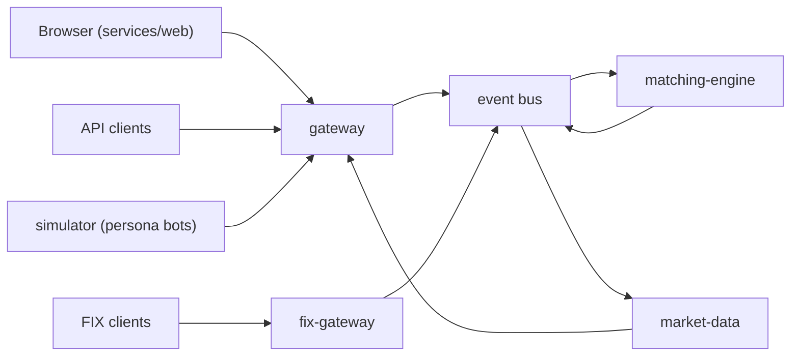

# devin-demo

A brokerage and exchange platform built around a price-time priority limit order book: a matching core with no
liquidity of its own, public REST/WebSocket and FIX gateways, pre-trade risk and a cash/position ledger, a market
simulator that supplies all the liquidity, and a React trading workstation on top.

**[Live demo](https://arthuryan-k.github.io/devin-demo/)**: the trading workstation running on in-browser demo data
(log in as `demo` / `demo1234`).

## What is this

A limit order book is the core of an exchange: buyers and sellers post orders at the prices they are willing to
trade, and the matching engine pairs them up, best price first and, at the same price, first come first served.
The matching engine hosts one order book per listed symbol (`ACME`, `GLOBX`, `INITD`, `NVTA`). Each book supports
limit and market orders, good-till-cancelled, immediate-or-cancel and fill-or-kill orders, amends, cancels and
self-trade prevention, and every order is recorded in a crash-safe journal.

The engine never quotes. Every order comes from outside, through the REST gateway or the FIX gateway, and passes a
pre-trade risk check against the participant's account first. A simulated market of persona traders (market makers,
takers, maintenance traders, whales), each with its own real account, supplies the liquidity. You can join it from
the browser, over the HTTP API or over FIX.

## Architecture

The system is a set of independently deployable services that communicate over a Kafka-compatible event bus
(Redpanda) for the order flow and over REST for synchronous lookups. The design choices that shape it:

- **Empty, sequencing core.** The matching engine is an in-memory, single-threaded sequencer per symbol behind an
  LMAX Disruptor pipeline. It owns no database and no HTTP API; its own journal and snapshots are its durable state.
- **One ordered stream per symbol.** Each symbol has its own book, pipeline, journal and topics, so symbols never
  contend with each other and each symbol's history is totally ordered.
- **Thin edges, one source of truth.** Gateways authenticate, rate-limit, convert decimal prices to integer ticks
  and run the risk check; the engine decides what trades. Downstream services (ledger, history, market data) derive
  their state from the engine's event stream.
- **Fail closed.** If authentication, risk or the bus is unavailable, an order is refused rather than sent on.
  Cash and shares are reserved before an order reaches the engine, so an account can never over-commit.
- **Crash-only recovery.** Any bus or journal error stops the engine; on restart it rebuilds from its journal and
  the bus so that every sequenced result is published exactly once, in order.
- **Polyglot by design.** Each service uses the toolchain that suits it, from a modern Java core to a legacy FIX
  acceptor and a Perl end-of-day batch, the way real brokerages accumulate systems.

Internals (matching rules, journal format, pipeline, recovery protocol, service contracts) are in
[ARCHITECTURE.md](ARCHITECTURE.md).

### Event bus

| Topic | Producer → consumers | Carries |
|---|---|---|
| `commands.<symbol>` | gateway, fix-gateway → matching engine | Place, Cancel and Amend commands |
| `events.<symbol>` | matching engine → gateways, portfolio, history-writer | each sequenced command with the events it produced (placements, trades, cancels, amends, rejections) |
| `marketdata.<symbol>` | matching engine → market-data | L2 book snapshots and contiguous deltas |

Every topic has a single partition keyed by symbol, so ordering is guaranteed per symbol. Messages are versioned
JSON with schemas in [`schemas/bus/`](schemas/bus/). A `correlationId` echoed from each command to its events
record lets the gateways do request/response over the bus. Details: [ARCHITECTURE.md](ARCHITECTURE.md#event-bus).

## Services

| Service | Stack | Responsibility |
|---|---|---|
| [`matching-engine`](services/matching-engine/) | Java 17, LMAX Disruptor | One order book, pipeline and journal per symbol; consumes `commands.*`, publishes `events.*` and `marketdata.*`. No built-in liquidity. |
| [`gateway`](services/gateway/README.md) | TypeScript, Fastify | The single public API: authentication, rate limits, risk check, orders onto the bus, history, portfolio and market-data proxying. |
| [`fix-gateway`](services/fix-gateway/README.md) | Java 8, legacy style | FIX 4.4 order entry onto the same topics and risk check as REST. |
| [`auth-service`](services/auth-service/README.md) | TypeScript, Fastify | Users, sessions (RS256 JWT), API keys and participant accounts. |
| [`reference-data-service`](services/reference-data-service/README.md) | TypeScript, Fastify | Listed instruments and their trading parameters. |
| [`risk`](services/risk/README.md) | Python, FastAPI | Synchronous pre-trade check that reserves cash or shares. |
| [`portfolio`](services/portfolio/README.md) | Python, FastAPI | System of record for cash and positions; settles fills from `events.*` and serves balances and P&L. |
| [`history-writer`](services/history-writer/README.md) | TypeScript, KafkaJS | Order lifecycle and trade history in Postgres, served per participant. |
| [`market-data`](services/market-data/README.md) | Python, FastAPI | Per-symbol WebSocket L2 feeds (snapshot, ordered deltas, resync on gaps). |
| [`simulator`](services/simulator/README.md) | Java 17 | Persona traders that sign up, get funded and trade through the public gateway like outside bots. |
| [`eod-recon`](services/eod-recon/README.md) | Perl 5, POSIX shell | Legacy end-of-day ledger reconciliation report and fixed-width clearing export. |
| [`web`](services/web/README.md) | React 18, TypeScript, Vite | The trading workstation; the same build runs against the gateway or an in-browser fake exchange. |

Postgres is the system of record for identities, accounts, reference data, the ledger and history; each service owns
its own tables, and the schema is managed by Flyway migrations in [`db/migrations/`](db/migrations/).

## Technology stack

| Language | Services | Build, lint and test |
|---|---|---|
| Java 17 | matching-engine, simulator | Maven, Checkstyle, JUnit 5, jqwik property tests, Redpanda integration tests |
| Java 8 | fix-gateway | Maven, Checkstyle, JUnit 5 |
| TypeScript (Node 20/22) | gateway, auth-service, reference-data-service, history-writer, web | npm, ESLint + Prettier, Vitest, Testcontainers, Playwright |
| Python 3.12 | risk, portfolio, market-data | pip, Ruff, pytest against Postgres and Redpanda |
| Perl 5 / shell | eod-recon | `perl -c`, `sh -n`, `prove` |
| SQL | Postgres schema | Flyway |

Infrastructure: Redpanda (Kafka API) event bus, Postgres 16, Docker Compose for the full stack, GitHub Actions for
CI and GitHub Pages for the live demo.

## Trading workstation

A dense, multi-panel trading UI in the style of a broker terminal: a watchlist of the four symbols, a per-symbol quote
header, price chart, L2 depth ladder and time & sales, an order ticket (`LIMIT`/`MARKET`, `GTC`/`IOC`/`FOK`), live
order management (modify, cancel), a portfolio view with shared cash, positions and realized/unrealized P&L, and
execution, order and trade history. See [`services/web`](services/web/README.md).

The [live demo](https://arthuryan-k.github.io/devin-demo/) is a static build of the same UI on a small fake exchange
that runs entirely in the browser.

## Repository layout

| Path | What it is |
|---|---|
| `services/` | One directory per deployable service, each on its own toolchain (see [Services](#services)). |
| `schemas/bus/` | JSON Schemas of the event-bus topics. |
| `db/migrations/` | Flyway SQL migrations for the brokerage database. |
| `tests/e2e/` | End-to-end checks against the running compose stack (simulator, accounts, FIX round trip). |
| `docker-compose.yml` | The full stack: Postgres and migrations, Redpanda, the matching engine and every service. |
| `.github/` | CI, security-scan, Pages workflows and Dependabot configuration. |
| `ARCHITECTURE.md` | Internals of every service. |

## CI and quality gates

- **Gating checks** ([`ci.yml`](.github/workflows/ci.yml), every pull request and `main`): a lint gate per language
  (ESLint + Prettier, Ruff, Checkstyle), unit and integration tests for every service (Testcontainers Postgres and
  Flyway, a real Redpanda broker for the bus services), the Perl batch's test suite, a full `docker compose` build,
  and a Playwright end-to-end run of the static workstation bundle.
- **Security scanning** (report-only, results in the Security tab): CodeQL for JavaScript/TypeScript, Python and
  Java ([`codeql.yml`](.github/workflows/codeql.yml)), and npm audit, pip-audit and Semgrep with repository rules
  in `.semgrep/` ([`security.yml`](.github/workflows/security.yml)).
- **Dependency updates:** Dependabot across npm, pip, Maven, Docker and GitHub Actions
  ([`dependabot.yml`](.github/dependabot.yml)).
- **Deploy:** [`pages.yml`](.github/workflows/pages.yml) publishes the live demo from `main`.

## Running locally

`docker compose up --build` from the repository root starts the whole stack, with the simulator trading on start.
The local stack's ports, smoke checks and bus examples are in
[ARCHITECTURE.md](ARCHITECTURE.md#running-the-stack-locally); each service's README covers its own build, test and
configuration.

---

For presenters: [demo guide](docs/DEMO.md).
