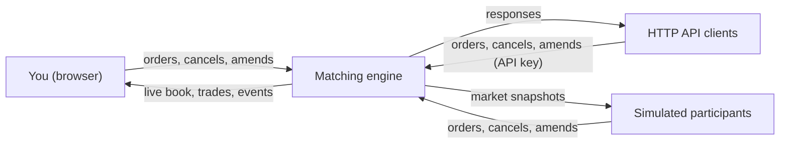

# devin-demo

A price-time priority exchange in Java 17, with a market simulator that trades against it, organized as a monorepo
for a growing set of services.

**[Live demo](https://arthuryan-k.github.io/devin-demo/)**

See [ARCHITECTURE.md](ARCHITECTURE.md) for internals (exchange core, per-symbol pipelines, journal, market data).

## Repository layout

| Path | What it is |
|---|---|
| `services/` | One directory per deployable service; each builds on its own toolchain. |
| `services/matching-engine/` | Java 17 / Maven: the exchange core (one matching engine, Disruptor pipeline and journal per symbol), participant HTTP API, market-data stream, market simulator and the TeaVM browser build. |
| `schemas/bus/` | JSON Schemas of the event-bus topics (`commands.<symbol>`, `events.<symbol>`, `marketdata.<symbol>`). |
| `services/auth-service/` | TypeScript / Fastify: signup, login (JWT), API keys and participant accounts in Postgres. |
| `services/reference-data-service/` | TypeScript / Fastify: the listed symbols and their trading parameters over REST. |
| `services/history-writer/` | TypeScript / KafkaJS: writes `events.<symbol>` order lifecycle and fills to Postgres and serves them per participant (`GET /v1/orders`, `/v1/trades`). |
| `db/migrations/` | Flyway SQL migrations for the brokerage database. |
| `docker-compose.yml` | Postgres, migrations, the Redpanda (Kafka API) event bus, the matching engine and the services above. |
| `ARCHITECTURE.md` | Internals of the services. |
| `.github/workflows/` | CI: tests the matching engine and deploys the live demo to GitHub Pages. |

Listed symbols (served by the reference-data service, built in otherwise): `ACME`, `GLOBX`, `INITD`, `NVTA`. Every book starts empty, with no liquidity and no price; the demo
and simulator currently trade `ACME`.

## What is this

A limit order book is the core of an exchange: buyers and sellers post orders at the prices they are willing to
trade, and the matching engine pairs them up, best price first and, at the same price, first come first served. The
matching engine hosts one order book per symbol; each supports limit and market orders, good-till-cancelled,
immediate-or-cancel and fill-or-kill orders, amends, cancels and self-trade prevention, with every order recorded in
a crash-safe journal. Around it sits an interactive demo: a simulated market full of trading bots, which you can
join and trade against from your browser or over an HTTP API.

## Using the demo

1. Open the [live demo](https://arthuryan-k.github.io/devin-demo/) and press **Simulate** to start the market. The
   simulation starts stopped.
2. You trade as participant **YOU**, with a cash and share balance.
3. Place limit or market orders, cancel them, or amend their price and quantity.
4. Watch the order book, the trade tape and the event log update live as your orders and the simulated
   participants' orders are matched.



## Participant API

Every participant, including each simulated one, is an API client identified by an API key.

| Endpoint | Auth | Purpose |
|---|---|---|
| `POST /participants/register` (optional form field `name`) | none | Returns `{"participantId":1001,"label":"name-1001","apiKey":"ob_…"}` |
| `POST /api/orders` (`side`, `type`, `price`, `qty`, `timeInForce`) | `X-Api-Key` | Place an order as that participant |
| `PATCH /api/orders/{id}` (`price` and/or `qty`) | `X-Api-Key` | Amend one of your resting orders |
| `DELETE /api/orders/{id}` | `X-Api-Key` | Cancel one of your resting orders |

```
KEY=$(curl -s -d name=alice localhost:8080/participants/register | sed 's/.*"apiKey":"\([^"]*\)".*/\1/')
curl -s -H "X-Api-Key: $KEY" -d 'side=BUY&type=LIMIT&price=99.50&qty=10' localhost:8080/api/orders
```

- With the auth service (`AUTH_SERVICE_URL`), registrations are real accounts in Postgres, and a signed-up user's
  session (`POST /auth/signup` or `/auth/login` on the [auth service](services/auth-service/README.md)) trades as
  that account.
- A missing or unknown key gets `401`; you can only amend or cancel your own orders.
- Each participant is limited to 200 messages/sec (burst 400) and 100 open orders; breaches get `429`.
- After 100 violations a participant is blocked with `403`. `POST /api/reset` clears the counters.

## Market simulator

- **Order flow:** orders arrive as a Poisson process (exponential inter-arrival times) at an adjustable rate.
- **Reference price:** a hidden fair value follows a random walk with rare jumps. Each jump starts a volatility
  shock that fades out over 12 seconds. During a shock, prices move more, market makers quote wider, and
  participants are more likely to leave.
- **Participants:** 2–8 are active at once. They join and leave over time, with more leaving after shocks. A
  participant cancels its resting orders before leaving.

| Persona | Share | Strategy |
|---|---|---|
| Market maker | ~58% | Posts small GTC quotes on both sides near the reference price. It re-quotes as the price drifts and refills an empty side of the book. Its spread and readiness to leave depend on its risk tolerance. It tracks the net of its own fills and shrinks its quotes on the side that would add to its inventory. |
| Aggressive taker | ~19% | Sends market and IOC orders, sometimes sweeping several levels. It follows recent drift, buying 55% of the time after the price rises and 45% after it falls. |
| Maintenance trader | ~19% | Keeps a few resting orders and cancels, resizes or reprices them. |
| Whale | ~4% | Occasionally sends a large market sweep, which triggers a volatility shock. |

## Your account

Balances live outside the engine. The portfolio service holds each account's shared cash, per-symbol positions and
P&L, and the risk service reserves cash or shares before an order reaches the engine. In this standalone demo, `YOU`
trades without a balance check.

## Build and run

From `services/matching-engine/`:

```
mvn test                              # engine, simulator, server and property tests
mvn compile exec:java                 # local server at http://localhost:8080/ (SIM_SEED=42 for a fixed seed)
scripts/build-pages.sh                # static browser build into target/pages
mvn verify                            # plus the Redpanda integration tests (needs Docker)
```

### On the event bus

From the repo root, `docker compose up --build` starts a Redpanda broker and the matching engine as a standalone
service: send Place / Cancel / Amend JSON to `commands.<SYMBOL>` and read the sequenced results from
`events.<SYMBOL>` and L2 market data from `marketdata.<SYMBOL>` (Kafka at `localhost:19092`):

```
docker compose exec redpanda rpk topic produce commands.ACME -k ACME
{"type":"Place","participantId":7,"correlationId":"c-1","side":"BUY","price":10000,"qty":5}
docker compose exec redpanda rpk topic consume events.ACME
```

Topic formats: [`schemas/bus/`](schemas/bus/); topology and recovery: [ARCHITECTURE.md](ARCHITECTURE.md#event-bus).

### Full brokerage stack

The same `docker compose up --build` also starts Postgres (with the migrations applied), the auth service on `:8081`,
the reference-data service on `:8082` and the history writer:

```
curl -s localhost:8082/symbols
curl -s -H 'content-type: application/json' -d '{"username":"alice","password":"correct-horse"}' localhost:8081/auth/signup
docker compose exec postgres psql -U brokerage -c 'select * from trades_history order by id desc limit 5'
```

To run the server on top of them, start it with `AUTH_SERVICE_URL=http://localhost:8081 REFDATA_URL=http://localhost:8082 mvn compile exec:java`.
Service ownership and contracts are in [ARCHITECTURE.md](ARCHITECTURE.md#brokerage-services-and-postgres).
