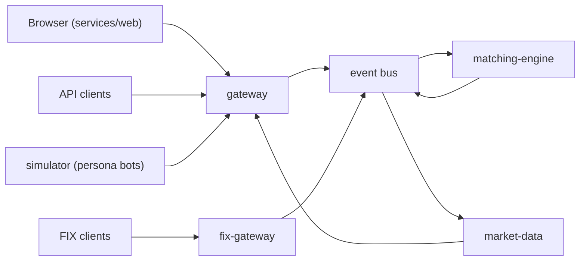

# devin-demo

A multi-asset, price-time priority exchange as a monorepo of services: an empty matching core, a public REST/WebSocket
gateway, a legacy FIX gateway, a market simulator that supplies all the liquidity, and a professional
React/TypeScript trading workstation on top.

**[Live demo](https://arthuryan-k.github.io/devin-demo/)** — the trading workstation running on in-browser demo data (log in as `demo` / `demo1234`).

See [ARCHITECTURE.md](ARCHITECTURE.md) for internals (exchange core, per-symbol pipelines, journal, bus, services).

## Repository layout

| Path | What it is |
|---|---|
| `services/` | One directory per deployable service; each builds on its own toolchain. |
| `services/matching-engine/` | Java 17 / Maven: the exchange core (one matching engine, Disruptor pipeline and journal per symbol) on the event bus. No built-in liquidity. |
| `services/simulator/` | Java 17: the market simulator, a load generator of persona traders that each sign up for a real account and trade over the gateway. See its [README](services/simulator/README.md). |
| `services/fix-gateway/` | Java 17, deliberately old-style: FIX 4.4 order entry onto the same bus topics. See its [README](services/fix-gateway/README.md). |
| `services/gateway/` | TypeScript / Fastify: the single public API. It authenticates callers, rate-limits them, checks risk, places orders on the bus and returns the engine's result. Clients use decimal prices. See its [README](services/gateway/README.md). |
| `services/market-data/` | Python / FastAPI: per-symbol WebSocket L2 feeds (snapshot, then ordered deltas, with resync on gaps). See its [README](services/market-data/README.md). |
| `services/web/` | React 18 / TypeScript / Vite: the trading workstation. The same build runs against the gateway or, for the live demo, an in-browser fake exchange. |
| `schemas/bus/` | JSON Schemas of the event-bus topics (`commands.<symbol>`, `events.<symbol>`, `marketdata.<symbol>`). |
| `services/auth-service/` | TypeScript / Fastify: signup, login (JWT), API keys and participant accounts in Postgres. |
| `services/reference-data-service/` | TypeScript / Fastify: the listed symbols and their trading parameters over REST. |
| `services/history-writer/` | TypeScript / KafkaJS: writes `events.<symbol>` order lifecycle and fills to Postgres and serves them per participant (`GET /v1/orders`, `/v1/trades`). |
| `db/migrations/` | Flyway SQL migrations for the brokerage database. |
| `tests/e2e/` | End-to-end checks against the running compose stack (simulator, accounts, FIX round trip). |
| `docker-compose.yml` | Postgres, migrations, the Redpanda (Kafka API) event bus, the matching engine and the services above. |
| `ARCHITECTURE.md` | Internals of the services. |
| `.github/workflows/` | CI: tests the matching engine and the web app, and deploys the live demo to GitHub Pages. |

Listed symbols (served by the reference-data service, built in otherwise): `ACME`, `GLOBX`, `INITD`, `NVTA`. Every book starts empty, with no liquidity and no price; the
simulator trades all four.

## What is this

A limit order book is the core of an exchange: buyers and sellers post orders at the prices they are willing to
trade, and the matching engine pairs them up, best price first and, at the same price, first come first served. The
matching engine hosts one order book per symbol; each supports limit and market orders, good-till-cancelled,
immediate-or-cancel and fill-or-kill orders, amends, cancels and self-trade prevention, with every order recorded in
a crash-safe journal. The engine itself never quotes: every order comes from outside, through the REST gateway or
the FIX gateway. A simulated market full of trading bots supplies the liquidity, and you can join it from the
browser, over the HTTP API or over FIX.



## Trading workstation

A dense, dark, multi-panel trading UI in the style of a professional broker terminal:

- **Login / open account**, then a workstation for the four listed symbols.
- **Watchlist** with last, change, bid/ask and volume; click a row to switch symbol.
- **Per-symbol market**: quote header, price chart (line or 15-second candles with volume), L2 depth ladder with
  your own resting size marked, and time & sales.
- **Order ticket**: buy/sell, `LIMIT`/`MARKET`, `GTC`/`IOC`/`FOK`, with estimated cost and available funds/shares.
  Click a depth level to pre-fill the price.
- **Live orders**: modify (price/quantity) and cancel working orders.
- **Portfolio**: one shared cash balance across symbols, reserved cash, available funds, per-symbol positions with
  reserved shares, average cost, mark, market value, and realized/unrealized/session P&L.
- **Executions, order history and trade history** from the account's history.

### Live demo

The [live demo](https://arthuryan-k.github.io/devin-demo/) is a static build of the same UI. It runs a small fake
exchange in the browser: synthetic liquidity and trade flow around a random walk, a seeded portfolio and history,
and your orders matched against the synthetic book. No backend is involved; nothing leaves the browser.

### Run the UI locally

From `services/web/` (Node 20):

```
npm ci
npm run dev:mock                      # UI on the in-browser fake exchange at http://localhost:5173/
npm run dev                           # UI against the gateway (GATEWAY_URL, default http://localhost:8080)
npm test                              # component and integration tests (Vitest)
npm run test:e2e                      # builds the static Pages bundle and drives it in Chromium (Playwright)
npm run build:pages                   # static Pages bundle into dist-pages/
```

`npm run dev` proxies `/api` to `GATEWAY_URL` and `/ws` to `MARKET_DATA_URL` (default: the gateway).

## Market simulator

The simulator (`services/simulator/`) is the only source of liquidity and price discovery. It runs a population of
persona traders on every symbol, each with its **own real account**, signing up and trading through the public
gateway exactly like an outside bot. Stop it and the books drain.

- **Order flow:** orders arrive as a Poisson process at an adjustable rate, spread over the four symbols.
- **Reference price per symbol:** a hidden fair value follows a random walk with drift and rare jumps. Each jump
  starts a volatility shock that fades out: prices move more, market makers quote wider and participants leave more.
- **Participants:** they join and leave over time; a participant cancels its resting orders before leaving.
- **Reproducible:** the arrival process is reproducible from a seed (the exchange's sequence numbers are not; see
  [ARCHITECTURE.md](ARCHITECTURE.md#clock-and-determinism)).

| Persona | Share | Strategy |
|---|---|---|
| Market maker | ~58% | Posts small GTC quotes on both sides near the reference price. It re-quotes as the price drifts and refills an empty side of the book. Its spread and readiness to leave depend on its risk tolerance. It shrinks its quotes on the side that would add to its inventory. |
| Aggressive taker | ~19% | Sends market and IOC orders, sometimes sweeping several levels. It follows recent drift, buying 55% of the time after the price rises and 45% after it falls. |
| Maintenance trader | ~19% | Keeps a few resting orders and cancels, resizes or reprices them. |
| Whale | ~4% | Occasionally sends a large market sweep, which triggers a volatility shock. |

Control it on `:8095`:

```
curl -s localhost:8095/admin/status
curl -s -X POST localhost:8095/admin/stop                      # everyone leaves, cancelling their orders
curl -s -X POST localhost:8095/admin/start
curl -s -X POST 'localhost:8095/admin/rate?value=50'           # orders per second, all symbols
curl -s -X POST 'localhost:8095/admin/participants?value=6'    # target population per symbol
curl -s -X POST 'localhost:8095/admin/reset?seed=7'
```

## FIX gateway

`services/fix-gateway/` accepts FIX 4.4 sessions on `:9878`: Logon with your API key as the password (tag 554), then
NewOrderSingle, OrderCancelRequest and OrderCancelReplaceRequest, answered with ExecutionReports. FIX orders go
through the same risk check and onto the same bus topics as REST orders, so a FIX client and a REST client trade in
the same book.

```text
8=FIX.4.4|9=..|35=A|49=ME|56=FIXGW|34=1|52=...|98=0|108=30|553=alice|554=ob_...|10=...
8=FIX.4.4|9=..|35=D|49=ME|56=FIXGW|34=2|52=...|11=c1|55=ACME|54=1|40=2|44=100.25|38=10|59=1|10=...
```

## Build and run

From `services/matching-engine/`:

```
mvn test                              # engine, pipeline, journal, bus codec and property tests
mvn verify                            # plus the Redpanda integration tests (needs Docker)
```

### On the event bus

From the repo root, `docker compose up --build` starts a Redpanda broker and the matching engine as a standalone
service: send Place / Cancel / Amend JSON to `commands.<SYMBOL>` and read the sequenced results from
`events.<SYMBOL>` and L2 market data from `marketdata.<SYMBOL>` (Kafka at `localhost:19092`):

```
docker compose exec redpanda rpk topic produce commands.ACME -k ACME
{"type":"Place","participantId":7,"correlationId":"c-1","side":"BUY","price":10000,"qty":5}
docker compose exec redpanda rpk topic consume events.ACME
```

Topic formats: [`schemas/bus/`](schemas/bus/); topology and recovery: [ARCHITECTURE.md](ARCHITECTURE.md#event-bus).

### Full brokerage stack

The same `docker compose up --build` also starts Postgres (with the migrations applied), the auth service on `:8081`,
the reference-data service on `:8082` and the history writer:

```
curl -s localhost:8082/symbols
curl -s -H 'content-type: application/json' -d '{"username":"alice","password":"correct-horse"}' localhost:8081/auth/signup
docker compose exec postgres psql -U brokerage -c 'select * from trades_history order by id desc limit 5'
```

Service ownership and contracts are in [ARCHITECTURE.md](ARCHITECTURE.md#brokerage-services-and-postgres).

### Through the gateway

Clients reach the exchange through the gateway (`localhost:8080`). Sign up, then trade with decimal prices:

```
TOKEN=$(curl -s localhost:8080/api/auth/signup -H 'content-type: application/json' \
  -d '{"username":"alice","password":"correct-horse"}' | jq -r .token)
curl -s localhost:8080/api/orders -H "authorization: Bearer $TOKEN" -H 'content-type: application/json' \
  -d '{"symbol":"ACME","side":"BUY","price":"10.25","qty":3}'
# {"orderId":...,"symbol":"ACME","seq":0,"events":[{"type":"OrderPlaced","price":"10.25","qty":3,...}]}
```

To stream the book, open a WebSocket at `ws://localhost:8080/marketdata/ACME/ws`.

### Full stack with the simulator

`docker compose up --build` also starts the risk and portfolio services, the gateway, market data, the simulator
(trading on start) and the FIX gateway. Point the workstation at it with `npm run dev` in `services/web/`. With the
stack up, `python3 tests/e2e/test_sim_fix_e2e.py` checks the simulator's accounts and flow, its controls, and a FIX
order filling against a REST order.
