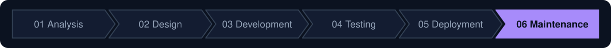

# Devin demo guide

> **Presenter material, not product documentation.** This page is a pitch aid for showing Devin to executives and
> CTOs. The product docs start at the [README](../README.md).

## The setting

**A real platform, with real work to do.**

- A working brokerage and exchange: limit order book matching engine, REST and FIX gateways, risk, a cash/position
  ledger, market data, a simulated market and a React trading workstation.
- A dozen services in Java, TypeScript, Python and Perl on a Kafka-compatible event bus, with Postgres, Docker
  Compose and gated CI.
- The demo walks the six SDLC phases: net-new feature work through Analysis, Design and Development, then a known
  target in each later phase. Some use cases span more than one phase and appear in each.
- Every change Devin makes arrives as a pull request; engineers review and merge.
- Each phase ends with a measurable outcome for a PoC on your code. Across all phases: share of Devin PRs merged,
  reviewer time per PR, and cost per merged PR against engineer hours.

---

## At a glance

| | Phase | Target | Where | Devin story |
|---|---|---|---|---|
| 01 | **Analysis** | Onboard onto an unfamiliar codebase, then scope a net-new feature | DeepWiki, Ask Devin | Onboard → understand → scope |
| 02 | **Design** | Technical design for that feature; migration plan for the legacy gateway | Bus schemas, `fix-gateway` | Scope → design → review |
| 03 | **Development** | Implement that feature | Engine, bus schemas, gateway, workstation | Design → code → PR |
| 04 | **Testing** | Static-analysis security findings; reporter-style bug tickets reproduced as failing tests | `history-writer`, `auth-service`, `eod-recon`, GitHub Issues | Scan → reproduce → fix |
| 05 | **Deployment** | Outdated dependencies and the Java 8 build of the legacy gateway | Dependency pins, Dependabot PRs, CI | Update → verify → ship |
| 06 | **Maintenance** | Bug tickets, scattered tech-debt markers and legacy migration | GitHub Issues, `TODO` / `FIXME` / `HACK`, `fix-gateway`, `eod-recon` | Reproduce → fix → modernize |

---

## 01 · Analysis: learn the codebase, scope a new feature

> **Outcome:** a written scope for a cross-service change, reviewed by an engineer before any code is written.

| Focus | Detail |
|---|---|
| **Onboarding** | Get a new engineer productive on a dozen services in four languages: DeepWiki for the architecture, service map and how the event bus ties them together |
| **Target** | A net-new product feature that cuts across services, for example stop and stop-limit orders (the engine today accepts only limit and market orders) |
| **How** | Ask Devin for the specifics: how an order travels from the gateway over the bus to the book, and every place that would have to change |
| **Showcases** | Devin turns a one-line product ask into a scope: the affected services and what each one has to do |
| **Measurable outcome** | Engineer sign-off on a scope for one of your roadmap items |

---

## 02 · Design: plan the change before writing it

> **Outcome:** a design an engineer reviews before implementation starts: contracts, risks and a test strategy.

| Focus | Detail |
|---|---|
| **Feature design** | The Analysis scope turned into a technical design: bus command schema changes, engine order-type handling, gateway API and the workstation order ticket |
| **Migration plan** | Also a Maintenance use case: the step-by-step plan for modernizing `services/fix-gateway` (see phase 06) |
| **Showcases** | Devin proposes contract changes, calls out risks and backward-compatibility concerns, and writes the test strategy |
| **Measurable outcome** | A design for one of your roadmap items, approved without a rewrite |

---

## 03 · Development: code the feature

> **Outcome:** one PR implementing the phase 02 design, with tests and green CI.

| Focus | Detail |
|---|---|
| **Target** | The feature designed in phase 02, implemented end to end: bus command schema, matching engine, gateway API and the workstation order ticket |
| **Showcases** | Devin writes the code across Java and TypeScript, adds tests, runs the stack, iterates on CI and opens a PR a human can review |
| **Measurable outcome** | That item shipped as a merged PR, tracked by review rounds and time to PR |

---

## 04 · Testing: scan → find → fix

> **Outcome:** one fix PR per confirmed finding, each with a test, across three languages.

| Focus | Detail |
|---|---|
| **Targets** | A SQL injection in `services/history-writer`; a timing-unsafe credential comparison in `services/auth-service`; an OS command injection in the legacy Perl/shell batch `services/eod-recon` |
| **How they surface** | CodeQL ([`codeql.yml`](../.github/workflows/codeql.yml)) and the report-only scanners in [`security.yml`](../.github/workflows/security.yml) (npm audit, pip-audit, Semgrep), including the rule set for the Perl batch in [`.semgrep/legacy-batch.yml`](../.semgrep/legacy-batch.yml) |
| **Bug tickets** | Also a Maintenance use case: each open ticket in [GitHub Issues](https://github.com/arthuryan-k/devin-demo/issues) reproduced as a failing test before it is fixed (see phase 06) |
| **Showcases** | Devin reads scanner output, confirms each finding is real, and opens a tested fix PR per finding |
| **Measurable outcome** | Your open scanner findings closed, confirmed by a clean re-scan |

---

## 05 · Deployment: keep the release path current

> **Outcome:** a prioritized update plan and PRs for the low-risk updates, each landing through the gated CI.

| Focus | Detail |
|---|---|
| **Dependencies** | Deliberately downgraded dependency pins with known CVEs (for example `services/market-data/requirements.txt`), plus an open backlog of Dependabot update PRs across npm, pip, Maven, Docker and GitHub Actions ([`dependabot.yml`](../.github/dependabot.yml)) |
| **Build and CI** | Also a Maintenance use case: `services/fix-gateway` still builds and runs on Java 8 in CI; the migration in phase 06 moves its build and CI job forward |
| **Showcases** | Devin groups and prioritizes the updates (security vs. routine vs. breaking major versions) and opens PRs for the low-risk ones with CI green, leaving the risky calls to a human |
| **Measurable outcome** | Your dependency backlog triaged: updates merged, CVEs cleared |

---

## 06 · Maintenance: bug tickets, tech debt and legacy migration (headline)

> **Outcome:** per ticket, a fix PR with a regression test; scoped tickets for the debt; and a legacy migration as one
> reviewable PR, verified against existing tests and the running stack.

| Focus | Detail |
|---|---|
| **Bug tickets** | A set of open bug tickets in [GitHub Issues](https://github.com/arthuryan-k/devin-demo/issues), written from the reporter's side: symptoms, not causes. Devin reproduces the problem, finds the root cause, and ships a fix with a regression test |
| **Tech debt** | `TODO`, `FIXME` and `HACK` markers left across services, for example `services/portfolio/portfolio/consumer.py`, `services/eod-recon/bin/eod_recon.pl` and `services/fix-gateway`, turned into scoped, prioritized tickets |
| **Legacy migration** | `services/fix-gateway`, a FIX 4.4 gateway written to Java 5 idioms and pinned to Java 8 in CI: thread per socket, raw collections, a hand-rolled tag=value codec, boxed-number constructors and per-message date formatters |
| **Scope** | Modernize to Java 17 (or port to QuickFIX/J): about 16 source files, plus the build and its CI job |
| **Smaller alternative** | Port the legacy Perl/shell `services/eod-recon` batch to a modern language, keeping its report and clearing-file formats |
| **Showcases** | Devin plans, executes and verifies the migration against the existing tests and the running stack |
| **Measurable outcome** | Real tickets from your backlog closed with regression tests, your debt markers triaged into tickets, and one of your legacy modules migrated with existing tests passing and behavior unchanged |

---

## Security and deployment

| Question | Answer |
|---|---|
| Does Devin merge its own changes? | It opens pull requests and is subject to the same branch protections and SDLC policies as any engineer; your engineers review and decide whether to merge. [Source](https://docs.devin.ai/essential-guidelines/sdlc-integration#working-within-existing-engineering-processes) |
| Is our code used for training? | Not for Enterprise customers without express prior written consent. [Source](https://docs.devin.ai/admin/security) |
| Where does it run? | Enterprise Cloud (Cognition-managed), or Customer Dedicated Deployment: a single-tenant VPC connected to your network over AWS PrivateLink or an IPSec tunnel. Customer-managed keys come with Enterprise Assured. [Source](https://docs.devin.ai/enterprise/deployment/overview) |
| Certifications and encryption? | Cognition is SOC 2 Type II certified (since September 2024); data is encrypted in transit and at rest. [Source](https://docs.devin.ai/admin/security#third-party-audits-and-certification) |
| What can it access? | Only the repositories you grant it. Secrets are encrypted at rest and can be scoped to the organization or to a single repository. [Source](https://docs.devin.ai/product-guides/secrets#repo-specific-secrets) |
| Identity and audit? | Enterprise SSO over OIDC or SAML, custom roles mapped to IdP groups, and enterprise audit logs through the API. [Source](https://docs.devin.ai/enterprise/security-access/sso/guide#custom-roles) |
