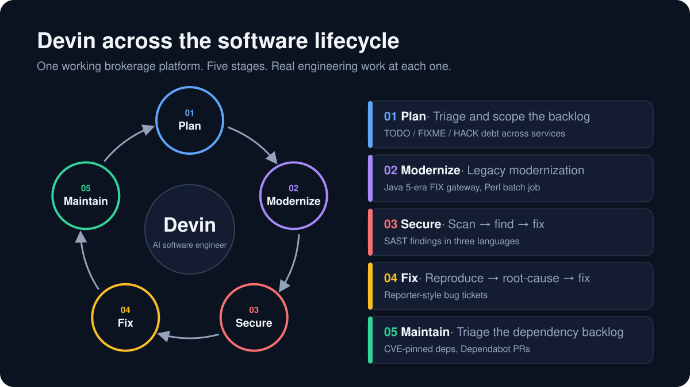

# Devin demo guide

> **Presenter material, not product documentation.** This page is a pitch aid for showing Devin to executives and
> CTOs. The product docs start at the [README](../README.md).

---

## The setting

**A real platform, with real debt.**

- A working brokerage and exchange: limit order book matching engine, REST and FIX gateways, risk, a cash/position
  ledger, market data, a simulated market and a React trading workstation.
- A dozen services in Java, TypeScript, Python and Perl on a Kafka-compatible event bus, with Postgres, Docker
  Compose and gated CI.
- Targets were planted at every stage of the lifecycle, so Devin can be shown doing real engineering work end to
  end on code it has not seen before.

---

## At a glance

| | Stage | Target | Where | Devin story |
|---|---|---|---|---|
| 01 | **Plan** | Scattered `TODO` / `FIXME` / `HACK` markers | `portfolio`, `eod-recon`, `fix-gateway` | Triage and scope the backlog |
| 02 | **Modernize** | Legacy Java gateway and a Perl batch job | `fix-gateway`, `eod-recon` | Legacy modernization |
| 03 | **Secure** | Static-analysis security findings | `history-writer`, `auth-service`, `eod-recon` | Scan → find → fix |
| 04 | **Fix** | Reporter-style bug tickets | GitHub Issues | Reproduce → root-cause → fix |
| 05 | **Maintain** | Outdated, CVE-bearing dependencies and an open update backlog | Dependency pins, Dependabot PRs | Triage the backlog |

---

## 01 · Plan: triage and scope the tech-debt backlog

> **The pitch:** before writing any code, Devin turns scattered debt into a plan.

| | |
|---|---|
| **Target** | `TODO`, `FIXME` and `HACK` markers left across services, for example `services/portfolio/portfolio/consumer.py`, `services/eod-recon/bin/eod_recon.pl` and `services/fix-gateway` |
| **Showcases** | Devin inventories the debt, assesses impact and effort for each item, and turns it into a scoped, prioritized set of tickets |

---

## 02 · Modernize: legacy migration (headline)

> **The pitch:** a multi-file migration that teams postpone for years, planned and delivered as one reviewable PR.

| | |
|---|---|
| **Target** | `services/fix-gateway`, a FIX 4.4 gateway written to Java 5 idioms and pinned to Java 8 in CI: thread per socket, raw collections, a hand-rolled tag=value codec, boxed-number constructors and per-message date formatters |
| **Scope** | Modernize to Java 17 (or port to QuickFIX/J): about 16 source files, plus the build and its CI job |
| **Smaller alternative** | Port the legacy Perl/shell `services/eod-recon` batch to a modern language, keeping its report and clearing-file formats |
| **Showcases** | Devin plans, executes and verifies the migration against the existing tests and the running stack |

---

## 03 · Secure: scan → find → fix

> **The pitch:** scanner findings go from a report to merged fixes, across three languages.

| | |
|---|---|
| **Targets** | A SQL injection in `services/history-writer`; a timing-unsafe credential comparison in `services/auth-service`; an OS command injection in the legacy Perl/shell batch `services/eod-recon` |
| **How they surface** | CodeQL ([`codeql.yml`](../.github/workflows/codeql.yml)) and the report-only scanners in [`security.yml`](../.github/workflows/security.yml) (npm audit, pip-audit, Semgrep), including the rule set for the Perl batch in [`.semgrep/legacy-batch.yml`](../.semgrep/legacy-batch.yml) |
| **Showcases** | Devin reads scanner output, confirms each finding is real, and lands a tested fix PR per finding |

---

## 04 · Fix: scope and fix bug tickets

> **The pitch:** hand Devin a ticket the way you would hand it to a teammate.

| | |
|---|---|
| **Target** | A set of open bug tickets in [GitHub Issues](https://github.com/arthuryan-k/devin-demo/issues), written from the reporter's side: symptoms, not causes |
| **Showcases** | Devin reproduces the problem, finds the root cause, and ships a fix with a regression test |

---

## 05 · Maintain: triage the dependency backlog

> **The pitch:** the update backlog nobody wants to own, sorted and cleared.

| | |
|---|---|
| **Targets** | Deliberately downgraded dependency pins with known CVEs (for example `services/market-data/requirements.txt`), plus an open backlog of Dependabot update PRs across npm, pip, Maven, Docker and GitHub Actions ([`dependabot.yml`](../.github/dependabot.yml)) |
| **Showcases** | Devin groups and prioritizes the updates (security vs. routine vs. breaking major versions), merges the safe ones with CI green, and writes up the risky ones for a human decision |
